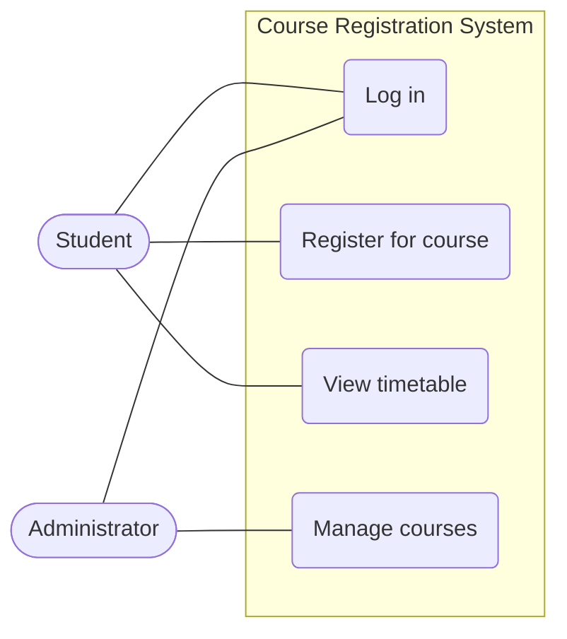
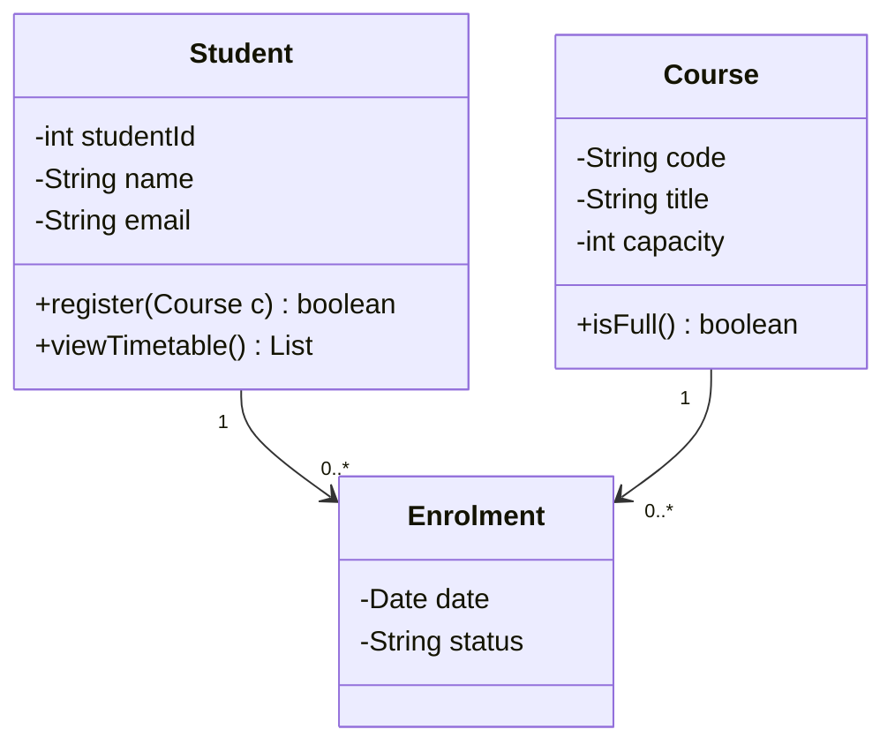
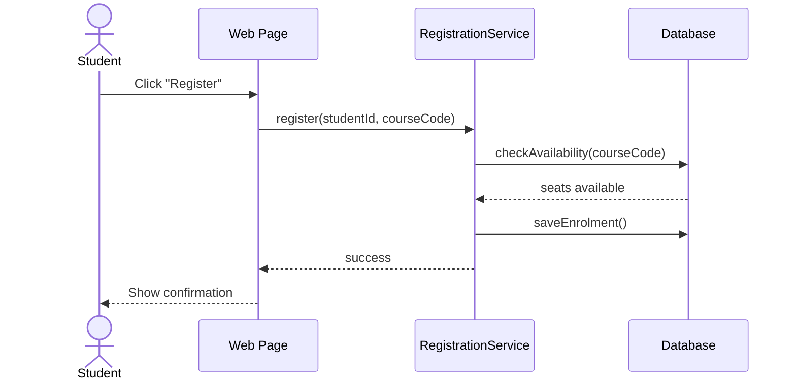
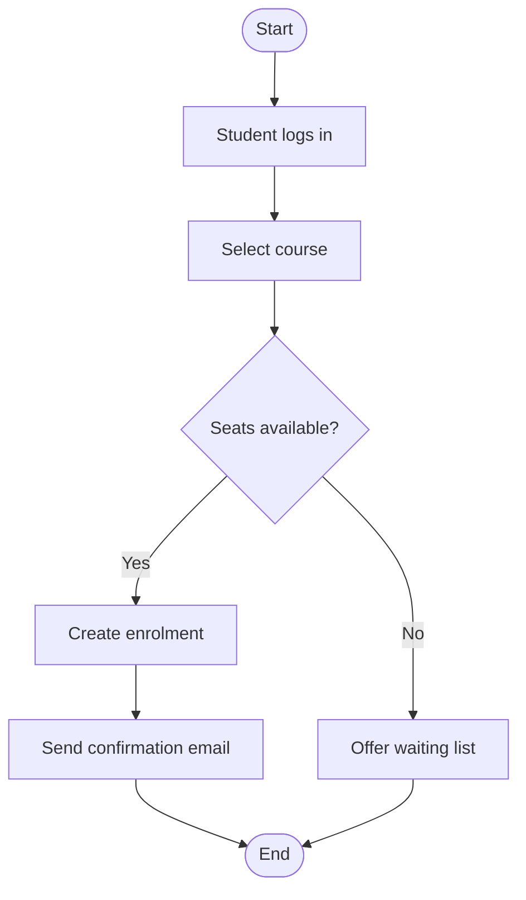

# Design and Modelling Tools

## 1. Introduction to Software Design and Modelling

**Software design** decides how a system will be structured to meet its requirements. A **model** is a simplified representation of the system that helps people understand, discuss, and plan it before (or while) writing code.

### Why model?

- Communicate ideas with teammates and clients using a shared visual language.
- Find mistakes early, when they are cheap to fix.
- Document the system for future maintainers.
- Manage complexity by looking at one aspect at a time.

### UML

The **Unified Modeling Language (UML)** is the standard notation for modelling software. UML diagrams fall into two groups:

- **Structural**: what the system is made of (Class diagram).
- **Behavioural**: what the system does over time (Use Case, Sequence, Activity diagrams).

---

## 2. Sparx Enterprise Architect

**Sparx Systems Enterprise Architect (EA)** is a commercial modelling platform that supports UML, SysML, BPMN, and ArchiMate. It is popular in industry and education.

### Key features

- Create all standard UML diagrams.
- **Model repository**: elements are stored once and reused across many diagrams.
- **Traceability**: link requirements, use cases, classes, and tests.
- **Code engineering**: generate code from class diagrams and reverse-engineer code into diagrams.
- **Documentation generation**: produce reports from the model.
- **Version control integration** with systems such as Git and SVN.
- **Team collaboration** via shared repositories.

### Basic steps to create a diagram in EA

1. Open EA and choose **File > New Project** to create a model file (`.qea` or `.eapx`).
2. Select a model pattern, for example *Software Engineering > UML Structural*.
3. In the **Browser** window, right-click a package and choose **Add Diagram**.
4. Pick the diagram type (for example *Use Case*).
5. Drag elements from the **Toolbox** onto the canvas and connect them.
6. Save the project and commit the file to Git if working in a team.

---

## 3. Core UML Diagrams

The examples below use an **online course registration system**.

### 3.1 Use Case Diagram

Shows **who** uses the system (actors) and **what** they can do (use cases).

Main elements: actors, use cases, the system boundary, and relationships (association, include, extend).

*(GitHub renders Mermaid blocks automatically. Mermaid has no dedicated use case syntax, so a flowchart is used to approximate it.)*

**Use case description:**

| Field | Content |
|-------|---------|
| Name | Register for course |
| Actor | Student |
| Precondition | Student is logged in |
| Main flow | 1. Student selects a course. 2. System checks availability. 3. System confirms registration. |
| Alternative flow | If the course is full, the system offers the waiting list. |

### 3.2 Class Diagram

Shows the **classes**, their **attributes** and **methods**, and the **relationships** between them. It is the most common structural diagram.

Visibility symbols: `+` public, `-` private, `#` protected.
Multiplicity: `1` exactly one, `0..*` zero or more.

### 3.3 Sequence Diagram

Shows **how objects interact over time** by exchanging messages. Time flows downward.

Solid arrows are calls; dashed arrows are return messages.

### 3.4 Activity Diagram

Shows the **flow of activities** in a process, including decisions and parallel steps. It resembles a flowchart.

### Which diagram should I use?

| Question | Diagram |
|----------|---------|
| Who uses the system and for what? | Use Case |
| What are the main things and how are they related? | Class |
| In what order do objects talk to each other? | Sequence |
| What are the steps of a process or algorithm? | Activity |

---

## 4. Alternative Modelling Tools

| Tool | Cost | Notes |
|------|------|-------|
| **Visual Paradigm** | Commercial, with a free Community Edition | Full UML support, code generation, good for teams and teaching. |
| **StarUML** | Commercial licence with trial | Lightweight desktop UML tool with extensions. |
| **draw.io (diagrams.net)** | Free | Browser or desktop, integrates with GitHub and Google Drive. Flexible but not a model-aware tool. |
| **PlantUML** | Free, open source | Write diagrams as text, which works well with Git. |
| **Mermaid** | Free, open source | Text-based diagrams rendered directly in GitHub Markdown. |
| **Lucidchart** | Freemium | Browser-based, collaborative. |

### Text-based vs graphical tools

- **Graphical tools** (EA, Visual Paradigm, draw.io): easy to draw and polish, but the files are harder to compare in Git.
- **Text-based tools** (Mermaid, PlantUML): diagrams are plain text, so Git can show exactly what changed in a pull request.

---

## Key Points

- Models help teams understand and communicate a design before coding.
- Enterprise Architect is a full-featured modelling platform with traceability and code engineering.
- Use Case, Class, Sequence, and Activity diagrams answer different questions.
- Free alternatives such as draw.io, PlantUML, and Mermaid are good for coursework.

## References

- Sparx Systems Enterprise Architect: https://sparxsystems.com
- UML specification: https://www.omg.org/spec/UML
- Visual Paradigm: https://www.visual-paradigm.com
- StarUML: https://staruml.io
- draw.io: https://www.drawio.com
- Mermaid documentation: https://mermaid.js.org
- GitHub Docs, creating diagrams: https://docs.github.com/en/get-started/writing-on-github/working-with-advanced-formatting/creating-diagrams
